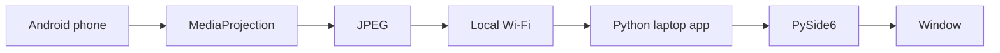

# Phone Remote

View and control your own Android phone from your laptop, over the Wi-Fi you are already on.

The laptop runs a Python window, or any other laptop on the same Wi-Fi opens a browser. The phone runs a small Android app. The phone shows its screen, and the other device sends clicks, typing, Back, Home, Recents, files, and clipboard text back to it. The two devices talk directly. There is no account, no cloud relay for the picture, and no USB session.

```text
        INTERNET
           X
           |
     not required
           |
     +-----+-----+
     |           |
   phone       laptop
     |           |
     +--- Wi-Fi -+
```

If the internet drops and both devices stay on the same router, the session continues.

## What it does

1. The phone advertises itself on the local network. The laptop lists it, or you type its private IP.
2. The first connection shows a 6-digit code on the laptop. You type that code on the phone. Later connections reuse a saved token.
3. After you start screen sharing on the phone, the laptop window shows the phone screen.
4. You click and drag that picture to touch the phone, type into a focused text field, and press Back, Home, and Recents.
5. You drag a file onto the window to send it to the phone, or send a file from the phone into the project's `downloads` folder.
6. Copied text can move either way.
7. The status line shows the device, IP, latency, frames per second, and Wi-Fi. A dropped link retries until you disconnect.

## Architecture

The phone is the server. The laptop is the client. One WebSocket on port 8765 carries JSON commands and binary JPEG frames. The phone finds itself with mDNS (`_ahsanremote._tcp.local`). The laptop searches with the `zeroconf` package.

Screen capture uses Android `MediaProjection`. Frames are JPEG, about 15 per second, scaled to fit inside a 1280 by 1280 box while keeping the phone's aspect ratio. Touch and typing use an accessibility service that you turn on yourself. The app does not root the phone and does not hide the system "screen is being shared" indicator.

The full picture, including why JPEG was chosen and why two Android services exist, is in [docs/architecture.md](docs/architecture.md). The message layouts are in [shared/protocol.md](shared/protocol.md).



## Any laptop, just a browser

The Python window on this computer stays. An office laptop does not need Python installed.

The phone hosts the viewer at `http://PHONE_IP:8080`. That address is shown in Phone Remote. Open it in Chrome on the other laptop. The page has a light theme and a dark theme, and the phone picture is sized to the phone so it stays large and sharp.

The public site is only the front door. You type the phone’s Wi-Fi address there, and the browser then opens the phone directly. The live picture never passes through the internet. Both devices still have to be on the same network.

One computer can be paired at a time. Pairing the browser replaces a previously paired Python window until you pair that window again.

## Requirements

- A laptop with Python 3.11 or newer, on Windows, macOS, or Linux.
- Your own Android phone, Android 8 or newer. Android 10 or newer is the comfortable case for saved downloads. A real phone is required. The emulator cannot be reached over Wi-Fi without USB, and this project does not use USB for the session.
- Both devices on the same Wi-Fi, with client isolation off, and with any VPN off.
- The file `PhoneRemote.apk` in this folder, sent to the phone and installed from there.
- No Docker, no database, and no paid service.

## Python installation

From this folder:

```powershell
python -m venv venv
.\venv\Scripts\activate
pip install -r requirements.txt
```

On macOS or Linux, activate with `source venv/bin/activate`.

Installed packages:

| Package | Role |
| --- | --- |
| PySide6 | Desktop window and JPEG decode |
| websockets | Client socket |
| zeroconf | Local discovery |
| PyYAML | `config.yaml` |

## Android setup

Send `PhoneRemote.apk` to the phone and tap it to install. Do not send `app-debug.apk`. That debug file is what the phone rejects with "App not installed." The steps are in [docs/setup.md](docs/setup.md).

## Run the laptop application

With the virtual environment active, from this folder:

```powershell
python laptop/main.py
```

The window lists phones it finds. Settings writes `config.yaml`. Logs go to `logs/phone_remote.log`.

```yaml
device_name: My PC

network:
  port: 8765

stream:
  width: 1280
  height: 1280
  fps: 15
  quality: medium

connection:
  reconnect: true
  reconnect_interval_sec: 2

clipboard:
  auto_sync: true
```

`width` and `height` are a maximum box, not a stretched resolution. `quality` is `low`, `medium`, or `high`.

## Run the Android application

Open Phone Remote on the phone. Allow the notification. The screen shows the Wi-Fi address and says it is listening. Leave the notification in place when you switch to other apps. Stopping the notification, or force-stopping the app, ends the session.

## How pairing works

The laptop generates the code and shows it. The phone does not invent the code. You read it on the laptop and type it on the phone, then press Pair.

```text
Laptop                          Phone
  |                               |
  |  hello                        |
  |------------------------------>|
  |  auth_required                |
  |<------------------------------|
  |                               |
  |  shows 839421                 |
  |  pair_begin                   |
  |------------------------------>|
  |                               |  you type 839421
  |  pair_submit                  |
  |<------------------------------|
  |  pair_ok + random token       |
  |------------------------------>|
```

The token is saved on the laptop in `data/paired_devices.json` and on the phone in private app preferences. The next `hello` includes the token, so the code is not asked again. Five wrong codes close the connection. Press Forget on either side to throw the token away. There is no account and no password reset server.

The code is checked on the laptop. A person who can see your Wi-Fi still cannot finish pairing unless they can see the code on your laptop screen.

## How the Wi-Fi connection works

1. The phone opens a WebSocket server on port 8765 and advertises `_ahsanremote._tcp` with mDNS. That is multicast on the LAN. It does not use a public DNS name.
2. The laptop browses for that service and prefers a private IPv4 address.
3. If discovery fails, type the address shown in the phone app. The laptop accepts only private addresses (`192.168.x.x`, `10.x.x.x`, `172.16.x.x`–`172.31.x.x`), link-local addresses, and loopback for local tests. A host name is rejected so a typo cannot be resolved on the internet.
4. The phone also rejects a connected client whose source address is not private. Do not port-forward 8765. A connection that arrives from the internet is closed.
5. Only one laptop is accepted at a time.
6. After a drop, the laptop retries every two seconds until you press Disconnect. A public address is not retried.

## Required Android permissions

| Feature | What you allow |
| --- | --- |
| Stay reachable | Notifications, and optionally "ignore battery optimizations" |
| See the screen | MediaProjection dialog, every time you press Start screen sharing |
| Click, type, Back, Home, Recents | Phone Remote accessibility service, turned on by you |
| Find the phone | Wi-Fi multicast, used only for mDNS |

Screen viewing works without accessibility. Control does not. On Android 13 and newer, a sideloaded app may need Allow restricted settings before the accessibility switch can be turned on. The exact taps are in [docs/android_permissions.md](docs/android_permissions.md).

The app does not request broad storage access. Files you send to the phone go to `Downloads/PhoneRemote`. Files you pick on the phone use the system file picker.

## Troubleshooting

| What you see | What to do |
| --- | --- |
| No phone found | Same Wi-Fi, VPN off, phone app open, then type the IP shown on the phone |
| Pairing failed | Type the code currently on the laptop. Forget both sides if the apps were reinstalled |
| Screen capture permission is required | On the phone, press Start screen sharing and accept the system dialog |
| Picture works, clicks do not | Turn on the accessibility service |
| Connection lost | Leave the phone app running. The laptop retries. Open the phone app if a vendor battery saver killed it |
| Colors swapped | On the phone, enable Swap red and blue |

Longer versions of each case are in [docs/troubleshooting.md](docs/troubleshooting.md).

## Known limitations

- You must accept the screen-capture dialog every time sharing starts. Android does not let an app save that consent.
- The system cast icon and the in-app banner stay visible while the screen is shared.
- Typing uses the accessibility text action. Games and some custom views do not expose a text field, so those fields cannot be typed into. The laptop says so. This app will not inject raw key events to get around that.
- Escape performs Back. It is not an Escape key.
- Right-click is a long press.
- Arrow keys work only in fields that expose cursor movement or a selection.
- Reading the phone clipboard from the background is blocked on Android 10 and newer. Use Send clipboard to laptop while the phone app is open.
- JPEG uses more bandwidth than H.264. A busy screen can be several megabits per second. The picture pauses while a file is copying, so the file and the frames do not clog one socket.
- One paired laptop at a time. Pairing a new laptop replaces the token.
- Some phone vendors kill the service when the screen locks unless you allow autostart.
- The color order is correct on common devices. If a device reverses red and blue, use the checkbox on the phone. Do not assume every device is identical.

## Security considerations

This is a personal tool for devices you own, on a network you trust enough to be on.

- The socket is not published to the internet, and public source addresses are rejected. Still, do not create a port forward.
- Unknown clients cannot control the phone. They must complete the pairing code, and only one client is allowed.
- The token is random and stored locally. It is not a password you reuse, and the phone app disables Android backup so the token is not uploaded by Auto Backup.
- The phone shows a banner and a notification while a laptop is connected and while the screen is shared. Do not dismiss them to "hide" the session. Hiding them is not a feature.
- Clipboard auto-sync will send text you copy on the laptop, including passwords, to the phone. Turn it off in Settings if you do not want that.
- The token and clipboard text are not written to the log. The log records that a clipboard moved and how many characters it had.
- Anyone on the same Wi-Fi can see the JPEG traffic, because the socket is plain `ws://`. Use this on your own network. It is not a remote-access product for untrusted networks, and it is not encrypted.

## Project layout

```text
phone_remote/
├── laptop/            Python window, socket client, input, files
├── android/           Kotlin app: capture, accessibility, socket server
├── shared/            Protocol notes and the Python message constants
├── tests/             Discovery, pairing, reconnect, protocol, files
├── docs/              Architecture, setup, permissions, troubleshooting
├── config.yaml
├── requirements.txt
└── README.md
```

## Tests

With the virtual environment active:

```powershell
python -m unittest discover -s tests -v
```

The tests do not need a phone. They do not turn on the window. They cover address filtering, a fake phone for connect, pair, and reconnect, the JSON and binary messages, and small and large file reassembly including a bad checksum.

## Configuration and logs

Edit `config.yaml` or use Settings in the window. Do not put secrets in that file. The pairing token lives only in `data/paired_devices.json`.

Logging uses the standard library:

```text
2026-09-27 21:30:12 INFO Device discovered: My Phone at 192.168.1.105:8765
2026-09-27 21:30:15 INFO Connection established
2026-09-27 21:30:16 INFO Screen streaming started
2026-09-27 21:31:04 INFO File transfer started: photo.jpg (5242880 bytes)
```
