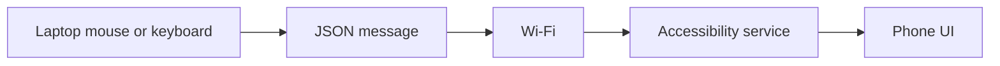
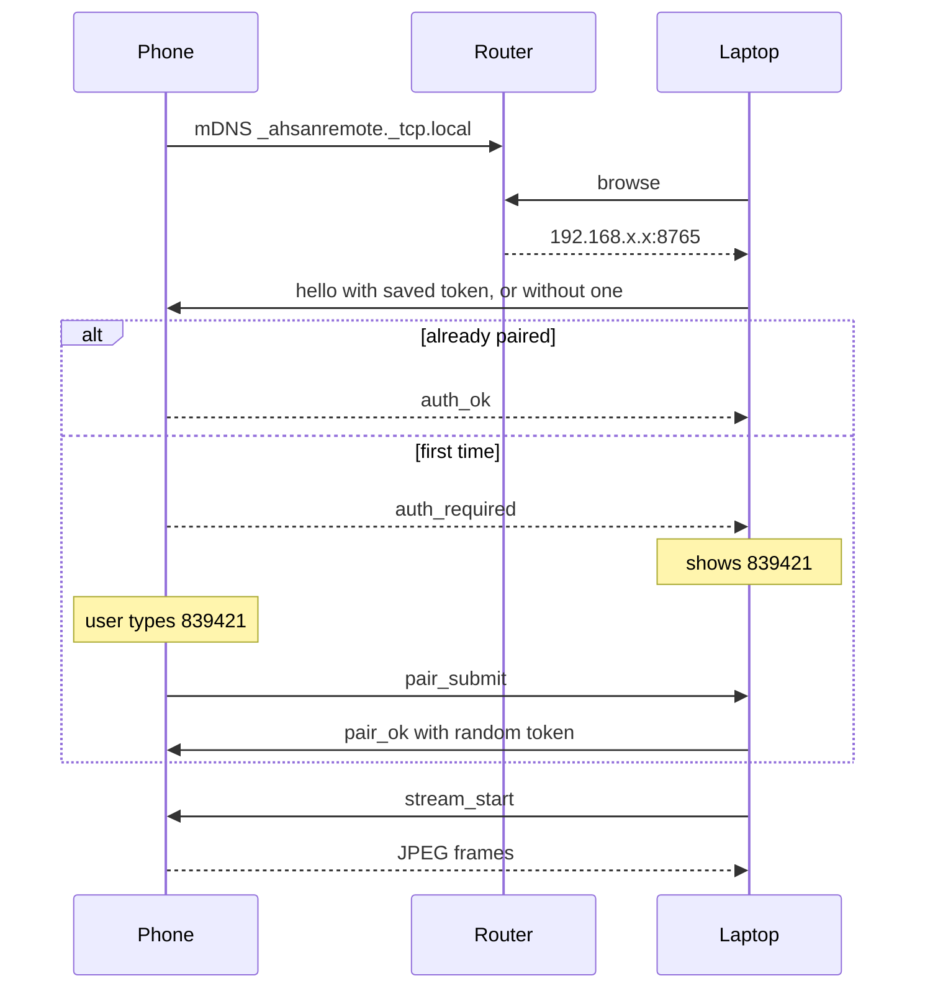

# Architecture

Phone Remote is two programs on one Wi-Fi network. The phone captures its own screen and accepts input. The laptop draws that screen and sends the mouse and keyboard. Nothing in the basic path uses the internet, a server you do not own, or USB.

```mermaid
flowchart LR
    Phone[Android phone]
    Capture[MediaProjection]
    Encode[JPEG encoder]
    Socket[WebSocket on the phone]
    Wifi[Same Wi-Fi router]
    Laptop[Python laptop app]
    Decode[PySide6 JPEG decode]
    UI[PySide6 window]

    Phone --> Capture
    Capture --> Encode
    Encode --> Socket
    Socket --> Wifi
    Wifi --> Laptop
    Laptop --> Decode
    Decode --> UI
```



The internet is not on this path. If the WAN link drops and both devices stay associated to the same router, the session keeps working.

## Why the phone is not Python

Android does not let a normal app read the screen or inject touch. Those two things require platform APIs:

- `MediaProjection` plus a virtual display, for the picture. The user must accept the system dialog every time sharing starts. A foreground service of type `mediaProjection` is required on Android 14.
- `AccessibilityService.dispatchGesture` and `ACTION_SET_TEXT`, for touch and typing. The user must turn the service on in system settings.

There is no supported pure-Python way to call those APIs on a phone you did not root. The phone app is therefore a small Kotlin app. It does not add a framework beyond the Android libraries and one MIT-licensed WebSocket server (`Java-WebSocket`). The laptop remains the application you configure and look at.

The phone does not use hidden input injection, root, or a private `INJECT_EVENTS` permission. If an app does not expose a text field to accessibility, typing into it is refused and the laptop is told.

## Why the phone listens

The phone already has the screen and the accessibility service, so it is the server. The laptop discovers it and connects. One WebSocket is enough:

- Text frames are small JSON commands.
- Binary frames are JPEG pictures or file chunks.

A second socket, WebRTC, or a separate video process would add failure points without helping the first version. Large file transfers pause the picture on purpose so they do not fight the frames for the same socket.

## Why the picture is JPEG

The capture path is:

```text
Phone screen
    -> MediaProjection
    -> VirtualDisplay
    -> ImageReader RGBA frames
    -> Bitmap JPEG compress
    -> WebSocket binary frame
    -> PySide6 QImage
    -> window
```

JPEG was chosen instead of H.264, H.265, or WebRTC:

- The phone already has `Bitmap.compress`. No encoder pipeline to debug.
- PySide6 decodes JPEG. FFmpeg, OpenCV, and Pillow are not required.
- Each frame stands alone, so a lost frame does not smear the next ones. There is no keyframe delay.
- 15 frames per second at a long side of about 1280 pixels is a reasonable Wi-Fi load. Quality is a setting.

The cost is bandwidth. A typical frame is tens of kilobytes, so a busy screen can use several megabits per second. That is acceptable on a home router and is the trade for a short, readable pipeline. H.264 can be added later if the Wi-Fi is weak. It is not in this version.

Default budget in `config.yaml`:

- Maximum box 1280 by 1280. The phone keeps its real aspect ratio inside that box, so a tall phone is not squashed into a 1280 by 720 landscape frame.
- 15 frames per second.
- JPEG quality "medium" (60).

The mouse is mapped from the window, through the letterboxed JPEG, back to real screen pixels. The frame header carries both sizes so a click lands on the right place after scaling.

## How control comes back



- Left drag is one continued gesture, so the finger stays down.
- Right-click without a drag is a long press.
- Letters, numbers, Backspace, Delete, Enter, and Space edit the focused text field with `ACTION_SET_TEXT`.
- Arrow keys try accessibility cursor movement, then fall back to moving the selection by one character.
- Escape performs Back. Android will not let this app inject `KEYCODE_ESCAPE`.
- Back, Home, and Recents use `performGlobalAction`.

If the accessibility service is off, the picture can still be viewed. Touch and keys cannot, and the laptop says so. That is a real limitation, not a placeholder.

## Discovery and pairing



mDNS is multicast on the LAN. It does not query a public DNS server. If the router isolates Wi-Fi clients, the list stays empty and you type the IP shown in the phone app. The manual address must be a private IP. Names are not resolved, so a typo cannot turn into an internet lookup.

The pairing code is generated on the laptop and checked on the laptop. A stranger on the Wi-Fi can open a socket, but they cannot finish pairing unless you type the code you see on your own screen. After that, the token is required. A second laptop is rejected while one is connected. A client whose source address is public is closed immediately, which blocks a router port-forward from the internet.

The token is stored in the clear on each device. That matches a personal app. It is not an account system, and phone backup of the app is disabled so the token is not uploaded by Android Auto Backup.

## What runs where

Laptop, started with `python laptop/main.py`:

- `laptop/ui` draws the window.
- `laptop/network/discovery.py` browses mDNS.
- `laptop/network/websocket_client.py` speaks the protocol.
- `laptop/streaming` checks JPEG frames and turns them into a `QImage`.
- `laptop/input` maps the pointer and the keys.
- `laptop/transfer` chunks files and checks SHA-256.

The Qt window and the socket do not share a thread. A small asyncio loop thread owns the socket and emits Qt signals back to the window.

Phone, one app, two foreground services in the same process:

- `RemoteForegroundService` (`connectedDevice`) keeps the process alive, serves the socket, and advertises mDNS. The notification is the visible "this app is running" signal.
- `ScreenCaptureService` (`mediaProjection`) exists only while you are sharing. Android requires that type for capture, so it is a second service class, not a second product.

Clipboard writes from the laptop use `ClipboardManager`. Reads from the background are blocked on Android 10 and newer, so phone-to-laptop clipboard is a button in the phone app, which is allowed to read while it is open.

Files from the laptop are saved under `Downloads/PhoneRemote` on Android 10 and newer, using the system download collection, so the app does not ask for broad storage access. Files from the phone are chosen with the system file picker.

## What this version does not do

- USB, including `adb`.
- A relay, account, or STUN/TURN server. It cannot cross the internet on purpose.
- H.264, audio, or remote camera.
- Root, or typing into games and custom views that hide their fields.
- More than one paired laptop at a time. Pairing a new laptop replaces the token.
